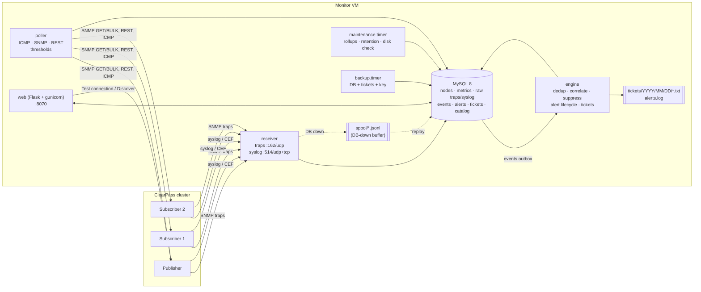
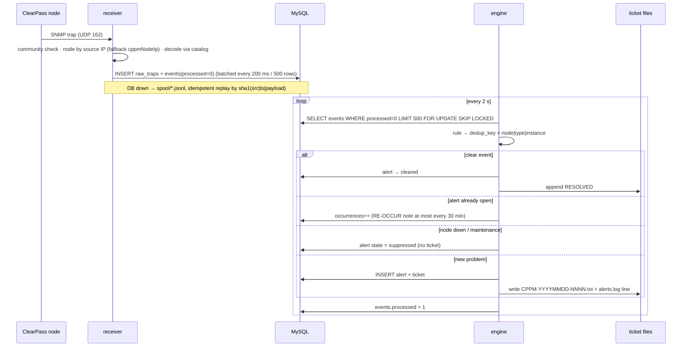
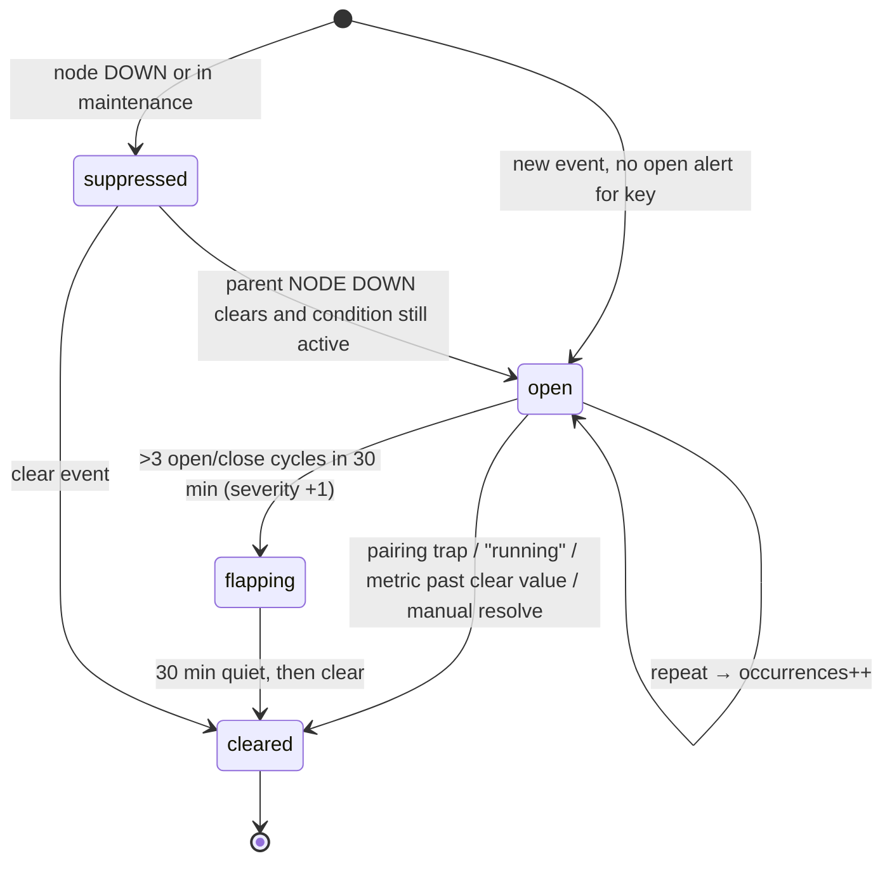

# Aruba ClearPass Monitoring System

**cppmmon 1.0.0-rc1**: a self-hosted monitoring and alerting system for **Aruba ClearPass Policy Manager (CPPM)** clusters.

It combines **proactive polling** (ICMP, SNMP, REST API) with **reactive event handling** (SNMP traps and syslog). The two feed one alert engine, which deduplicates, correlates and suppresses. Alerts are written out as **ServiceNow-ready ticket files**. A clean web UI covers dashboards, node onboarding, live trap and syslog tails, alerts, tickets, licenses and system health.


---

## Table of contents

1. [Why this exists](#1-why-this-exists)
2. [Features](#2-features)
3. [Architecture](#3-architecture)
4. [Repository structure](#4-repository-structure)
5. [Data model](#5-data-model)
6. [What is polled and what is reactive](#6-what-is-polled-and-what-is-reactive)
7. [Alert engine](#7-alert-engine)
8. [Ticket format](#8-ticket-format)
9. [Web UI](#9-web-ui)
10. [Requirements](#10-requirements)
11. [Installation](#11-installation)
12. [ClearPass-side configuration](#12-clearpass-side-configuration)
13. [Configuration reference](#13-configuration-reference)
14. [Operations](#14-operations)
15. [Testing and simulation](#15-testing-and-simulation)
16. [Security model](#16-security-model)
17. [Troubleshooting](#17-troubleshooting)
18. [Known limitations and roadmap](#18-known-limitations-and-roadmap)
19. [Documentation index](#19-documentation-index)
20. [License and disclaimer](#20-license-and-disclaimer)

---

## 1. Why this exists

ClearPass is often the single point of authentication for Wi-Fi, wired 802.1X, VPN and device administration (TACACS+). When a RADIUS service stops, an AD join breaks, a certificate expires or a cluster member falls out of sync, users notice before the NOC does.

CPPM exposes useful signals, but they are scattered:

- **CPPM-MIB** for SNMP polling, which is table-indexed and has quirks across versions.
- **Enterprise SNMP traps** for service stop/start, certificate and license expiry, cluster events, and more.
- **Built-in net-snmp watchdog traps** (DISMAN-EVENT-MIB) for about 20 service and process health checks.
- **The REST API** for services, certificates, licenses, cluster membership and endpoints.
- **Syslog**, including CEF System Events and Audit Records.

This project turns all of them into **one deduplicated alert per real problem** and **one ticket per alert**, with automatic clearing when the problem goes away.

**Design principle:** *ClearPass pushes what it can; the monitor polls only what ClearPass cannot push.* Polling costs CPU on both sides, so traps are the primary signal wherever they exist, and polling is the backstop.

---

## 2. Features

### Monitoring
- **Multi-signal node health:** ICMP RTT and loss, SNMP reachability and REST reachability. **NODE DOWN** requires ICMP *and* SNMP to fail for 3 consecutive cycles. *Degraded* means the node answers ping but its management plane is failing.
- **System KPIs:**
  - CPU %, computed from UCD raw ticks as deltas between polls;
  - memory % excluding cache, and disk % across all partitions;
  - load averages and uptime;
  - **reboot detection** from `cppmSystemUptime`, not `sysUpTime`.
- **Authentication KPIs:**
  - auth/min, failures/min, failure %, today's success %;
  - per auth source (AD/LDAP/SQL/…) request and failure rates.
- **Services:**
  - **every CPPM service**: RADIUS, TACACS+, Policy server, DB replication, Domain Server (AD), and the rest;
  - state comes from traps, the watchdog and a REST backstop, merged into **one alert per service**.
- **Certificates:** only the **installed RADIUS and HTTPS (RSA)** server certificates are polled, with days left. Any other certificate or trusted-root expiry that CPPM reports by trap is ticketed too.
- **Licenses:** per node and per application. Shows used and licensed counts, type, activation state, added date and computed expiry.
- **Cluster:** member discovery, role (publisher/subscriber), replication status and member-count drop.
- **Interfaces and mounts:** throughput, error rates, operational state and per-mount usage.

### Reactive
- **SNMP trap receiver** (UDP 162, v2c):
  - catalog-driven decoding of every CPPM-MIB trap plus DISMAN watchdog, coldStart/warmStart, link and agent traps;
  - **unknown OIDs are stored, never dropped**;
  - traps with a wrong community are stored for troubleshooting but raise no alert.
- **Syslog receiver** (UDP and TCP 514; LF and RFC 6587 octet-counted framing):
  - header parsing (RFC 3164/5424 and BSD with ISO timestamps) and format detection (CEF/LEEF/RFC5424/RFC3164/raw);
  - **credential masking before storage**, plus **repeat suppression** for noisy senders.
- **Spool and replay:** if the database is down, the receiver writes to JSONL spool files. It replays them idempotently when the database is back, so no trap is lost.

### Alerting and ticketing
- Dedup key `node | type | instance`, with **one open alert per key**. Repeats increase *occurrences* rather than creating new tickets.
- **Clear pairing** from traps (e.g. 1017 stop → 1018/1019 start), the watchdog ("is running"), REST ("Running") or **hysteresis** on polled metrics.
- **Flap guard**: more than 3 open/close cycles in 30 min marks the alert FLAPPING and raises severity by one.
- **Node-down suppression** of child alerts, **cluster-wide grouping** and **maintenance windows**.
- Severity → ServiceNow priority: Critical P1, High P2, Medium P3, Low/Info no ticket.
- **File ticket sink:** atomic `.txt` tickets in a ServiceNow-ready layout plus a JSON-lines `alerts.log` audit trail. Behind a `TicketSink` interface, so an API sink can be added.
- **Adaptive re-check:** while a service alert is open, the node's services are re-polled every 2 min instead of 15. CPPM does not always send a "started" trap, so this catches the recovery.

### Operations
- **Web UI** on :8070:
  - light and dark theme, auto-refresh, role-based access (admin/operator/viewer), CSRF on every form;
  - strict CSP with no inline scripts, and no CDN at runtime (HTMX and Chart.js are vendored).
- **Cluster discovery**: add the publisher, then click *Discover cluster* to add the subscribers. Credentials can be copied from the source node.
- **Poll now** buttons on the dashboard (all nodes), and per node on the Nodes, Overview and Licenses pages.
- **Health page**:
  - ingest rates, engine lag and spool backlog;
  - per-job poller timings and errors;
  - table sizes, monitor disk and latest backup.
- **Maintenance timer** (hourly): 5-minute rollups, retention and a monitor disk self-check.
- **Backup timer** (daily): a database dump plus ticket files plus config and encryption key, keeping 14.

---

## 3. Architecture

### 3.1 Planes and processes

The system runs as **four long-running systemd services** plus two timers on one Linux VM. They share one MySQL database.

| Plane | Service | Responsibility |
|---|---|---|
| Data plane (ingest) | `cppmmon-receiver` | Trap listener UDP/162, syslog listener UDP+TCP/514. Accepts packets fast and persists raw records plus normalised `events`. No business logic |
| Control plane | `cppmmon-poller` | Per-node, per-job scheduler (ICMP/SNMP/REST) with jitter and concurrency caps. Writes metrics and state, evaluates thresholds (sustain + hysteresis), emits events |
| Control plane | `cppmmon-engine` | Consumes the events outbox. Does dedup, correlation, suppression, clear pairing and flap guard. **The only writer of alerts and tickets** |
| Management plane | `cppmmon-web` | Flask + gunicorn UI and JSON endpoints on :8070. Onboarding, dashboards, catalog import, thresholds, tickets, health |
| Housekeeping | `cppmmon-maintenance.timer` | Hourly rollups, retention, monitor disk check |
| Housekeeping | `cppmmon-backup.timer` | Daily backup at 02:30 |

**Why four processes rather than one:** a slow poll, an engine bug or a UI restart must never block the trap socket. A blocked socket overflows the UDP buffer and loses traps. Each unit is small and restarts independently. Duplicate tickets are impossible, because only the engine writes alerts and tickets.

### 3.2 Component diagram



### 3.3 Reactive flow (trap → ticket)



### 3.4 Proactive flow (poll → event)

```
poller scheduler (per node, per job, ±10 % jitter, SNMP ≤ 50 / REST ≤ 20 concurrent)
  icmp 30 s │ snmp_system 60 s │ snmp_auth 5 min │ snmp_storage_if 5 min
  rest_services 15 min (2 min while a service alert is open) │ rest_endpoints 15 min
  rest_inventory 1 h │ rest_certs_licenses 6 h │ "Poll now" wakes every job within ~2 s
      │
      ├─▶ metrics / node_state / service_status / certificates / licenses
      └─▶ threshold evaluator (sustain window + hysteresis) ─▶ events(source=poll)
                                                               └─▶ same engine path as traps
```

### 3.5 Alert lifecycle



### 3.6 Architecture decisions (summary)

| ADR | Decision | Reason |
|---|---|---|
| 001 | **DB outbox table** (`events`, `FOR UPDATE SKIP LOCKED`) instead of Redis/Kafka | One fewer moving part. Transactional with the raw insert. Volumes are tiny for a NAC cluster |
| 002 | **MySQL** for metrics (raw 7 d + 5-min rollups 90 d) instead of a TSDB | Tens of series per node. Rollups keep it small |
| 003 | **Catalog-driven trap decoding** (YAML/CSV, importable) instead of compiled MIBs | Editable by operators. Unknown OIDs still stored |
| 004 | **Flask + gunicorn** for the UI; **asyncio** (pysnmp 7, httpx) inside receiver and poller | Simple server-rendered UI. Async where I/O fan-out matters |
| 005 | **TicketSink** abstraction with a `FileTicketSink` | Ships today; a ServiceNow API sink can be added without touching rules |
| 006 | Privileged ports via `AmbientCapabilities=CAP_NET_BIND_SERVICE` on the receiver only | No root processes. No port forwarding |

Full reasoning is in [docs/DESIGN.md](docs/DESIGN.md) §5.

---

## 4. Repository structure

```
Aruba_Clearpass_Monitoring_System/
├── README.md                     ← you are here
├── LICENSE                       MIT
├── CHANGELOG.md                  release notes and known limitations
├── CLAUDE.md                     phased build instructions used to develop the project
├── requirements.txt              pinned runtime dependencies
├── requirements.lock             full resolved dependency set
├── requirements-dev.txt          pytest, pytest-asyncio
├── alembic.ini · pytest.ini
│
├── catalog/
│   └── cppm_traps.yaml           seed trap + varbind catalog (32 traps, 47 varbinds)
│
├── cppmmon/                      the Python package
│   ├── __init__.py               __version__
│   ├── config.py                 pydantic-settings (env prefix CPPMMON_)
│   ├── logging_setup.py          JSON logs, daily rotation
│   ├── crypto.py                 Fernet encrypt/decrypt for node credentials
│   ├── services.py               canonical service keys (unit names), critical-service matcher
│   ├── cli.py                    cppmmon-admin (users, catalog import)
│   ├── db/
│   │   ├── models.py             SQLAlchemy 2 models
│   │   ├── session.py
│   │   └── migrations/           Alembic revisions
│   ├── catalog/loader.py         YAML/CSV import, validation, diff preview, partial upsert
│   ├── collectors/
│   │   ├── snmp_client.py        async GET/GETBULK/WALK (v2c + v3), per-OID parsing
│   │   ├── cppm_snmp.py          index discovery, system/policy/auth-source tables, UCD, hrStorage, IF-MIB
│   │   ├── cppm_api.py           OAuth token cache, cluster, services, certs, licenses, endpoints
│   │   ├── icmp.py               icmplib (unprivileged)
│   │   └── probe.py · types.py   Test-connection logic, shared result types
│   ├── receiver/
│   │   ├── main.py               one asyncio loop: trap + syslog listeners, batched writer
│   │   ├── decode.py             raw SNMP v1/v2c decode (pysnmp proto API)
│   │   ├── directory.py          node / community / catalog lookups
│   │   ├── framing.py            TCP LF + RFC 6587 octet counting
│   │   ├── syslog_parsers.py     header parse + format detection
│   │   ├── redact.py             credential masking
│   │   ├── suppress.py           repeat suppression
│   │   ├── persist.py            batch inserts, dedup hashes
│   │   └── spool.py              JSONL spool + idempotent replay
│   ├── poller/
│   │   ├── main.py               scheduler, wake-ups, Poll now, adaptive re-check
│   │   ├── jobs.py               job definitions and intervals
│   │   ├── deltas.py             counter delta / reset / 32-bit wrap
│   │   ├── thresholds.py         sustain window + hysteresis, default rules
│   │   └── store.py              metric / state writes
│   ├── engine/
│   │   ├── main.py               outbox consumer loop
│   │   ├── rules.py              event → alert decisions, clear pairing, watchdog classifier
│   │   ├── correlation.py        node-down suppression, flap guard, cluster grouping
│   │   └── tickets.py            TicketSink + FileTicketSink
│   ├── jobs/maintenance.py       rollups, retention, disk self-check
│   └── web/
│       ├── app.py · auth.py      Flask factory, login, roles, CSP
│       ├── routes/               main (dashboard, licenses, health), nodes, alerts, events, catalog
│       ├── templates/            Jinja templates (HTMX partials prefixed with _)
│       └── static/               css/app.css, js/, img/, vendor/ (htmx, Chart.js)
│
├── deploy/
│   ├── install.sh                idempotent installer (apt or dnf)
│   ├── cppmmon.env.example       config template
│   └── systemd/                  receiver, poller, engine, web, maintenance(.timer), backup(.timer)
│
├── tools/
│   ├── cppm_probe.py             CLI: test one CPPM (ICMP/SNMP/API) from the shell
│   ├── simulate_traps.sh         send every catalog trap (+ an unknown OID)
│   ├── simulate_syslog.sh        send CEF/LEEF/standard/plain samples over UDP and TCP
│   └── backup.sh                 DB dump + tickets + /etc/cppmmon, keep 14
│
├── tests/                        91 pytest tests + fixtures/syslog/
│
└── docs/
    ├── DESIGN.md                 architecture and design source of truth
    ├── RUNBOOK.md                install, operate, CPPM checklist, troubleshooting, cutover
    ├── UAT_PLAN.md               25 acceptance test cases + exit criteria
    ├── API_NOTES.md              CPPM 6.14 REST/SNMP/trap behaviour verified on real hardware
    └── DEVIATIONS.md             every place the build differs from DESIGN.md, and why
```

### On-disk layout after installation

| Path | Owner / mode | Contents |
|---|---|---|
| `/opt/cppmmon` | root 0755 | code, `venv/`, `requirements.lock` |
| `/etc/cppmmon/cppmmon.env` | root:cppmmon 0640 | DB URL, web secret, ports, tunables (generated once; never overwritten) |
| `/etc/cppmmon/secret.key` | root:cppmmon 0640 | Fernet key for node credentials. **Back it up** |
| `/var/lib/cppmmon/tickets/` | cppmmon 0750 | ticket `.txt` files + `alerts.log` |
| `/var/lib/cppmmon/spool/` | cppmmon 0750 | JSONL buffer while the DB is down |
| `/var/log/cppmmon/<service>.log` | cppmmon 0750 | JSON logs, 14 days |
| `/var/backups/cppmmon/` | root:cppmmon 0750 | daily backups |
| `/etc/sysctl.d/60-cppmmon-ping.conf` | root | unprivileged ICMP (`ping_group_range`) |

---

## 5. Data model

MySQL 8, InnoDB, utf8mb4, managed by Alembic. Main tables:

| Group | Tables | Notes |
|---|---|---|
| Inventory | `nodes`, `node_state` | Credentials stored **Fernet-encrypted** (`*_enc`). `node_state` has the discovered index, role, version, cluster UUID, last test, API state |
| Metrics | `metrics`, `metrics_5m`, `counter_state` | Raw samples (7 d) and 5-min avg/min/max rollups (90 d). Counter state for delta/reset/wrap |
| State | `service_status`, `certificates`, `licenses` | Latest polled state per node |
| Catalog | `trap_catalog`, `varbind_catalog` | OID → name, severity, category, clear OIDs, dedup field, templates |
| Raw ingest | `raw_traps`, `raw_syslog` | With `dedup_hash` for idempotent spool replay; `community_ok`, `truncated`, detected `fmt` |
| Outbox | `events` | `processed` 0 / 1 / 2 (poison) |
| Alerting | `thresholds`, `alerts`, `tickets`, `ticket_seq` | Alerts carry `occurrences`, `flapping`, `parent_alert_id`, `suppress_reason`, `attributes`. Daily ticket numbering lives in the DB |
| Platform | `users`, `audit_log`, `service_heartbeat`, `poll_requests` | bcrypt passwords, audit trail, health heartbeats, Poll-now queue |

Detail is in [docs/DESIGN.md](docs/DESIGN.md) §6 and `cppmmon/db/models.py`.

---

## 6. What is polled and what is reactive

### 6.1 Polled (the monitor asks ClearPass)

| Job | Interval | Protocol | Data | Can raise |
|---|---|---|---|---|
| `icmp` | 30 s | ICMP | RTT, loss | NODE DOWN (with SNMP) |
| `snmp_system` | 60 s | SNMP GET (1 PDU) | CPU, memory, disk, load, uptime, auth rate/failures, cluster size, hostname/version/model/role | CPU, memory, disk, auth failure %, reboot, cluster member drop, NODE DOWN / Degraded |
| `snmp_auth` | 5 min | SNMP walk | per auth source requests/failures | auth-source failure spike |
| `snmp_storage_if` | 5 min | SNMP walk | per-mount %, interface bps/errors/oper state | mount full, interface errors |
| `rest_services` | 15 min, **2 min while a service alert is open** | REST | state of every service | service down/up (backstop to traps) |
| `rest_endpoints` | 15 min | REST | endpoint count (`calculate_count=true&limit=1`; never pages) | trend only |
| `rest_inventory` | 1 h | REST | cluster members, role, replication, cluster identity | role change, replication not ENABLED |
| `rest_certs_licenses` | 6 h | REST | RADIUS + HTTPS(RSA) server certs; licenses | cert expiry (≤30 d Medium, ≤7 d High, expired Critical); license ≥90 % / ≥100 % |

### 6.2 Reactive (ClearPass pushes)

| Signal | Source | Alert | Clears on |
|---|---|---|---|
| Service stopped / started / restarted | CPPM-MIB trap `…200.1017` / `1018` / `1019` | `service.down`: **High** for RADIUS, TACACS, Policy, DB, replication and Domain services; Medium otherwise | 1018/1019 for the same service |
| Service health watchdog (~20 checks incl. AD *Domain Server*, postgres, httpd) | DISMAN-EVENT-MIB trap `1.3.6.1.2.1.88.2.0.x` | the same `service.down` alert | watchdog reports "is running" |
| Memory / disk / load watchdog | DISMAN trap | `watchdog.<trigger>` Medium | watchdog OK |
| Any certificate / trusted-root expiry | trap `…1003` | Medium, High at ≤ 7 d | manual / renewal |
| License expiry / usage / overrun | traps `…1001`, `1002`, `1016`, `1023` | Medium / High | 1016 below 85 % |
| Low disk / memory, high CPU | traps `…1004`, `1005`, `1021` | Medium | — |
| Cluster events (removed, promoted, disabled, out of sync) | traps `…1007`–`1010` | High, **one ticket per cluster** | — |
| Config reset / restore, core dump | traps `…1012`, `1013`, `1022` | High / Medium | — |
| Reboot | coldStart / warmStart | High / Medium | manual |
| Link up/down, SNMP agent start/stop | standard traps | log only | — |
| Unknown OID | anything not in the catalog | stored as `UNKNOWN_TRAP`, log only | — |
| Syslog | UDP/TCP 514 | stored and searchable (alert rules: roadmap) | — |

**One alert per service.** The stop trap, the watchdog trap and the REST poll all key on the service **unit name**, for example `cpass-tacacs-server`. The first signal opens the alert; later ones add occurrences; any "running" signal resolves it.

### 6.3 Default thresholds (editable in the UI)

| Rule | Metric | Warning → Medium | Critical → High | Clear | Sustain |
|---|---|---|---|---|---|
| cpu | `cpu_pct` | > 85 | > 95 | < 75 | 300 s |
| mem | `mem_pct` | > 85 | > 95 | < 75 | 300 s |
| disk | `disk_pct` | > 80 | > 90 | < 75 | 0 |
| disk_mount | `disk_mount_pct` | > 85 | > 95 | < 80 | 0 |
| auth_fail | `auth_fail_pct` (≥ 20 auths) | > 30 | > 60 | < 20 | 600 s |
| auth_src_fail | `auth_src_fail_per_min` | > 20 | — | < 5 | 300 s |
| license | `license_pct` | ≥ 90 | ≥ 100 | < 85 | 0 |
| cert | `cert_days_left` | ≤ 30 | ≤ 7 | > 30 | 0 (expired → Critical) |
| if_errors | `if_errors_per_min` | > 10 | — | < 1 | 300 s |

---

## 7. Alert engine

1. **Dedup key** = `node_id | event_type | instance`. The instance is the service unit, mount point, certificate and so on. Cluster-wide types key on the cluster (publisher UUID).
2. **One open alert per key.** Repeats increase `occurrences` and `last_seen`. A `RE-OCCUR` line goes to the ticket at most every 30 min. A higher severity appends `ESCALATE`.
3. **Clear** comes from:
   - a pairing trap (`clear_oid` + match field);
   - a watchdog "is running" or REST "Running";
   - a polled metric past its clear value (hysteresis);
   - a manual resolve.

   Each clear marks the ticket RESOLVED.
4. **Flap guard:** more than 3 open/close cycles in 30 min gives `FLAPPING:` with severity +1. Clears are held until 30 min of quiet.
5. **Node-down suppression:** while a node is DOWN, its other alerts are `suppressed` and linked to the parent. When the node recovers, alerts that are still active become normal alerts with their own tickets.
6. **Maintenance window:** alerts on a node with `maintenance_until` in the future are recorded as *suppressed (maintenance)*, with no ticket.
7. **Severity → priority:** Critical P1 (Impact 1 / Urgency 1), High P2, Medium P3, Low/Info no ticket.
8. **Poison events** (an exception while processing) are marked `processed=2` and skipped, so one bad event never blocks the queue.
9. **Manual resolve** from the UI inserts an internal clear event. The engine stays the only writer.

---

## 8. Ticket format

Tickets are written to `/var/lib/cppmmon/tickets/YYYY/MM/DD/CPPM-YYYYMMDD-NNNN.txt`. The NNNN counter is a daily sequence held in the DB. Each file is written atomically (tmp + fsync + rename), and updates are appended to the same file.

```
================================================================
TICKET      : CPPM-20261117-0007
CREATED     : 2026-11-17 14:32:05 IST
STATUS      : NEW
----------------------------------------------------------------
Caller              : CPPM-Monitor (automation)
Category            : Network
Subcategory         : AAA/NAC
Configuration Item  : cppm-pub-01 (192.0.2.10) | Publisher | 6.14.1 | SN: n/a
Assignment Group    : Network Operations
Impact / Urgency    : 2 / 2
Priority            : P2 - High
Short Description   : [CPPM][HIGH] RADIUS service stopped on cppm-pub-01
----------------------------------------------------------------
Description:
  Alarm Type     : Application Failure
  Source         : SNMP Trap (cppmServiceStopNotification, .1.3.6.1.4.1.14823.1.6.1.1.200.1017)
  First Seen     : 2026-11-17 14:32:04 IST
  Node           : cppm-pub-01 / 192.0.2.10
  Service        : Radius server
  Impact         : RADIUS authentication requests to this node will fail;
                   NADs fail over to the secondary RADIUS server if one is configured.
Evidence:
  raw_trap_id=12345  varbinds={...}
  Last poll: CPU 12% | Mem 61% | Disk 40% | Services: radius=STOPPED tacacs=RUNNING
Recommended Action:
  1. Verify in CPPM: Administration > Server Manager > Server Configuration > Services Control
  2. Check Event Viewer for the reason the service stopped
  3. Start the service; if it fails to start, escalate per matrix
----------------------------------------------------------------
UPDATES:
  2026-11-17 14:36:10  RESOLVED  cppmServiceStartNotification received (Radius server)
================================================================
```

Every lifecycle change also appends one JSON line to `tickets/alerts.log` (`opened`, `reoccurred`, `escalated`, `suppressed`, `cleared`). A SIEM or ITSM integration can ingest it easily.

---

## 9. Web UI

| Page | Purpose |
|---|---|
| **Login** | Local users (bcrypt). No default password; the first admin is created from the CLI |
| **Dashboard** | One tile per node: status, role, version, uptime, CPU/Mem/Disk gauges, auth rate, endpoints, RTT, key services, cert days, license usage, open alerts. Auto-refresh 30 s. **Poll all now**. Banner when a cluster has unmonitored members |
| **Nodes** | Add / edit / delete, **Run test** (ICMP, SNMP, API with latency and CPPM-side hints), **Poll now**, **Discover cluster** |
| **Node overview** | Charts (1 h – 7 d), services, monitored certificates, licenses, interfaces, mounts, auth sources, open alerts, recent traps and syslog |
| **Alerts** | Filter by state. Resolve one, **Resolve selected**, **Resolve all shown** |
| **Tickets** | List, text view with copy, `.txt` download |
| **Licenses** | Per node: application, used/licensed bar, type, activated, added, expiry |
| **Live Traps / Live Syslog** | Live tails with filters, row details, unknown-OID and rejected-community views |
| **Trap Catalog** | Decoding table; admins import CSV/YAML with an added/changed/unchanged diff preview |
| **Thresholds** | Edit the polled-metric rules |
| **Health** | Service heartbeats, ingest rates, engine lag, spool backlog, receiver/engine counters, poller job table, largest tables, monitor disk, last maintenance and backup |

Roles: **admin** (everything), **operator** (nodes, test, poll, discover, resolve, thresholds), **viewer** (read-only).

---

## 10. Requirements

| Item | Requirement |
|---|---|
| OS | Linux with systemd. Tested on **Ubuntu 24.04**. RHEL/Rocky 8/9 supported by `install.sh` (dnf path) |
| Python | **3.11+** (tested 3.12.3) |
| Database | **MySQL 8** (installed locally by `install.sh`; listens on 127.0.0.1 only) |
| CPU / RAM | 2 vCPU / 4 GB is plenty for a few clusters |
| Disk | Plan **≥ 50 GB for `/var`**. Syslog volume dominates; size it from the Health page after a few days of data |
| Network | Monitor → CPPM: ICMP, UDP 161, TCP 443. CPPM → monitor: UDP 162, UDP/TCP 514. Users → monitor: TCP 8070 |
| ClearPass | Tested on **CPPM 6.14.1** (3-node cluster). Other 6.x versions should work; REST differences are logged as `unsupported` per KPI |

Python dependencies (pinned in `requirements.txt`): Flask 3.1, Flask-Login, Flask-WTF, gunicorn, SQLAlchemy 2.0, Alembic, PyMySQL, cryptography, pydantic-settings, bcrypt, PyYAML, **pysnmp 7.1** (asyncio API), httpx, icmplib.

---

## 11. Installation

```bash
git clone https://github.com/TECHMONSTER2003/Aruba_Clearpass_Monitoring_System.git
cd Aruba_Clearpass_Monitoring_System

# Installs OS packages, creates the cppmmon user, venv, Fernet key, MySQL DB/user,
# env file, ICMP sysctl, runs migrations, seeds the trap catalog, installs systemd units
# and opens firewall ports (only if firewalld/ufw is active). Idempotent; safe to re-run.
sudo ./deploy/install.sh            # add --no-packages to skip apt/dnf

# Create the first admin (there is no default password)
sudo cppmmon-admin create-user <name> --role admin

# Check
systemctl status 'cppmmon-*'
curl -s -o /dev/null -w '%{http_code}\n' http://127.0.0.1:8070/login   # → 200
```

Then open `http://<monitor-ip>:8070` and do the following:
1. **Nodes → Add node** for the publisher: name, management IP, SNMP v2c community or a v3 user, trap community, and the API client. *Client credentials* grant is recommended; *password* grant is also supported.
2. **Run test**: ICMP, SNMP and API should all pass.
3. **Overview → Discover cluster**: tick the subscribers and copy credentials.
4. Configure ClearPass to send traps and syslog to the monitor (next section).

`install.sh` stops if ports 162, 514 or 8070 are already held by another process. It never disables SELinux or firewalld.

**Upgrade:** pull or copy the new code, then run `sudo ./deploy/install.sh --no-packages` again. Migrations run automatically, and the env file and key are never overwritten.

---

## 12. ClearPass-side configuration

Do this on **every** node unless marked *cluster-wide*. Menu paths are for CPPM 6.14.

| # | What | Where | Set to |
|---|---|---|---|
| 1 | SNMP agent | Administration › Server Manager › Server Configuration › *server* › **System Monitor** | v2c community or v3 user; allow the monitor IP |
| 2 | Trap destination | same page | host = monitor IP, UDP 162, community = the node's *Trap community* in the monitor |
| 3 | Service watchdog | same page | keep the built-in service/process monitors enabled (they produce the DISMAN traps) |
| 4 | REST API client (*cluster-wide*) | Guest › Administration › API Services › **API Clients** | grant *Client credentials*, operator profile with **read-only** API access |
| 5 | Allow the monitor IP | Server Configuration › Network › **Restrict Access** (if used) + any firewall | TCP 443, UDP 161 from the monitor |
| 6 | Syslog target | Administration › External Servers › **Syslog Targets** | monitor IP, port 514, UDP or TCP |
| 7 | Syslog Export Filters (*cluster-wide*) | Administration › External Servers › **Syslog Export Filters** | *System Events* and *Audit Records*, format **CEF** |
| 8 | *Async network services* log level | Server Manager › Log Configuration › Service Log Configuration | **INFO**, then restart the service (DEBUG logs SNMP requests incl. the community) |
| 9 | NTP | Server Configuration › System Time | the same NTP source as the monitor |

---

## 13. Configuration reference

Configuration lives in `/etc/cppmmon/cppmmon.env`, which pydantic-settings reads with the prefix `CPPMMON_`. The template is [deploy/cppmmon.env.example](deploy/cppmmon.env.example).

| Variable | Default | Purpose |
|---|---|---|
| `CPPMMON_DB_URL` | generated | SQLAlchemy URL (`mysql+pymysql://…`) |
| `CPPMMON_WEB_SECRET` | generated | Flask session secret |
| `CPPMMON_WEB_SESSION_HOURS` / `_COOKIE_SECURE` | 8 / false | session lifetime; set secure cookies behind HTTPS |
| `CPPMMON_RECEIVER_TRAP_PORT` / `_SYSLOG_PORT` | 162 / 514 | listener ports |
| `CPPMMON_SYSLOG_REPEAT_WINDOW_S` | 60 | repeat suppression window (0 = off) |
| `CPPMMON_CERT_MONITOR_SERVICES` | `RADIUS,HTTPS(RSA)` | which server certificates are polled |
| `CPPMMON_RETAIN_SYSLOG_DAYS` / `_TRAPS_` / `_EVENTS_` / `_METRICS_` / `_METRICS_5M_` | 30 / 90 / 30 / 7 / 90 | retention |
| `CPPMMON_DISPLAY_TZ` | Asia/Kolkata | time zone shown in the UI and tickets (storage is UTC) |
| `CPPMMON_TICKET_ASSIGNMENT_GROUP` / `_CALLER` | Network Operations / CPPM-Monitor (automation) | ticket fields |
| `CPPMMON_LOG_LEVEL` | INFO | logging |

After editing, run `sudo systemctl restart 'cppmmon-*'`.

---

## 14. Operations

```bash
systemctl status 'cppmmon-*'                         # all units
journalctl -u cppmmon-engine -f                      # follow a unit
tail -f /var/log/cppmmon/poller.log | jq -c '{ts,level,msg,node_id,job}'

sudo cppmmon-admin list-users
sudo cppmmon-admin set-password <name>
sudo cppmmon-admin catalog-import my_traps.csv        # preview; add --apply to write

sudo -u cppmmon /opt/cppmmon/venv/bin/python /opt/cppmmon/tools/cppm_probe.py --node <name-or-ip> [--json]
sudo systemctl start cppmmon-backup                  # on-demand backup
```

**Retention** (hourly timer):

| Data | Kept |
|---|---|
| raw syslog | 30 days |
| raw traps | 90 days |
| processed events | 30 days |
| raw metrics | 7 days, purged only after roll-up |
| 5-min metrics | 90 days |
| alerts, tickets | forever |
| backups | newest 14 |

The hourly run also raises an internal `monitor.disk_low` alert when the monitor's data disk passes 85 % used, and clears it below 80 %.

**Backups** go to `/var/backups/cppmmon/cppmmon-*.tar.gz` and contain a DB dump, the ticket files and `/etc/cppmmon`. The encryption key is included, so **copy backups off the VM and protect them.** Restore steps are in the header of [tools/backup.sh](tools/backup.sh).

---

## 15. Testing and simulation

```bash
# Unit/integration tests (91), run as the service user
sudo -u cppmmon bash -c 'cd /opt/cppmmon && venv/bin/python -m pytest -q'

# Send every catalog trap (+ one unknown OID) to the receiver
tools/simulate_traps.sh -c <trap-community> -t <monitor-ip>:162 [--only 1017,1018]

# Send CEF / LEEF / standard / plain syslog over UDP and TCP
tools/simulate_syslog.sh -t <monitor-ip>
```

The tests cover:
- the SNMP OID layout and per-OID parsing, and counter delta/reset/wrap;
- trap decoding (incl. unknown and wrong-community), syslog framing, header parsing, masking and suppression;
- the alert state machine (dedup, clear pairing, flap guard, node-down suppression, maintenance);
- ticket rendering, threshold sustain/hysteresis, web auth/roles/CSRF, node CRUD and discovery, rollups and retention.

A full user-acceptance plan with 25 cases and exit criteria is in [docs/UAT_PLAN.md](docs/UAT_PLAN.md).

---

## 16. Security model

- **No credentials in the repository or in config files.** SNMP communities, v3 keys and API secrets are entered in the UI. They are stored **Fernet-encrypted** with a key in `/etc/cppmmon/secret.key` (0640 root:cppmmon), are **write-only** in the UI (never rendered back) and are never logged.
- **Syslog masking:** `community=`, `password=`, `secret=` and pysnmp payload dumps are replaced with `***` before storage.
- **Least privilege:**
  - each service runs as the `cppmmon` system user with `NoNewPrivileges` and `ProtectSystem=strict`;
  - only the receiver gets `CAP_NET_BIND_SERVICE`;
  - MySQL listens on localhost only.
- **Web:**
  - bcrypt passwords, role-based access, CSRF tokens on every form and session expiry;
  - strict CSP (`script-src 'self'`), and no third-party requests at runtime.
- **TLS verification** to ClearPass is a per-node toggle (lab appliances are often self-signed). The UI warns when it is off.
- The UI is plain HTTP on :8070. **Put it behind HTTPS** (reverse proxy) in production and set `CPPMMON_WEB_COOKIE_SECURE=true`.

---

## 17. Troubleshooting

| Symptom | Likely cause / fix |
|---|---|
| SNMP test fails: "cppmSystemTable has no instances" | SNMP is answering but the CPPM-MIB index is unexpected. The monitor tries indexes 0–5 and then walks; check System Monitor SNMP settings |
| API test: HTTP 403 with an HTML page | The monitor's IP is blocked by *Restrict Access* or a firewall in front of CPPM |
| API test: `auth_failed` | Wrong client id/secret, or the API client's grant type does not match the node setting |
| No traps in Live Traps | Trap destination or community not set on that node. *Rejected* rows mean the community is wrong |
| A service stays "stopped" after it was started | CPPM may not send a "started" trap. The 2-min adaptive REST re-check clears it, or press **Poll now** |
| Huge syslog volume | *Async network services* at DEBUG. Set INFO and restart that service. Repeat suppression limits the damage meanwhile |
| Health shows spool backlog | MySQL is down or slow; the receiver replays automatically when it recovers |
| Engine lag growing | Check `journalctl -u cppmmon-engine`; poison events are skipped and counted on the Health page |

More detail is in [docs/RUNBOOK.md](docs/RUNBOOK.md) §15.

---

## 18. Known limitations and roadmap

**Known limitations in 1.0.0-rc1:**
- **Syslog alerting is not built yet.** Syslog is stored and searchable only. CEF parsers and rules are built from real captured samples and enabled after review.
- **AD/LDAP domain-controller reachability** alerts depend on syslog System Events. Covered today: the AD *Domain Server* service watchdog (trap) and auth-source failure counters (5-min poll).
- ClearPass does not always send a "service started" trap. Recovery is detected by the 2-min adaptive re-check rather than instantly.
- coldStart / warmStart / reboot alerts have no automatic clear; resolve them after verification.
- Link up/down traps are log-only (CPPM sends only an ifIndex, including docker bridges).
- **SNMPv3 traps** are not supported yet; SNMPv3 *polling* works.
- HTTP only on :8070 (use a reverse proxy for HTTPS).

**Roadmap:**
1. CEF/LEEF/CPPM key=value syslog parsers and syslog → event rules (System Events level ERROR, AD/LDAP unreachable, trusted-root expiry, audit changes).
2. SNMPv3 trap receiver (engine-ID configuration).
3. ServiceNow REST `TicketSink`.
4. Cisco ISE collectors (vendor-specific layers are already pluggable).

---

## 19. Documentation index

| Document | Contents |
|---|---|
| [docs/DESIGN.md](docs/DESIGN.md) | Requirements, research findings (CPPM-MIB, traps, REST, syslog), KPI → method mapping, architecture, ADRs, data model, alert rules, ticket format, edge cases, scaling path |
| [docs/RUNBOOK.md](docs/RUNBOOK.md) | Polled vs reactive matrix, CPPM checklist, install/upgrade, services, UI pages, onboarding, alerts, thresholds, syslog, retention, simulation, config, troubleshooting, production cutover |
| [docs/UAT_PLAN.md](docs/UAT_PLAN.md) | Prerequisites, 25 test cases, data to collect, exit criteria |
| [docs/API_NOTES.md](docs/API_NOTES.md) | Behaviour verified on CPPM 6.14.1: REST endpoints and responses, CPPM-MIB layout, trap varbinds, watchdog quirks |
| [docs/DEVIATIONS.md](docs/DEVIATIONS.md) | 45 recorded differences between design and build, with reasons |
| [CHANGELOG.md](CHANGELOG.md) | Release notes |

---

## 20. License and disclaimer

Released under the [MIT License](LICENSE).

This is an independent project. It is **not affiliated with, endorsed by or supported by Hewlett Packard Enterprise or Aruba Networks**. "Aruba", "ClearPass" and related names are trademarks of their respective owners and are used only to describe compatibility. IP addresses in the documentation and tests are from the RFC 5737 documentation range (192.0.2.0/24).
