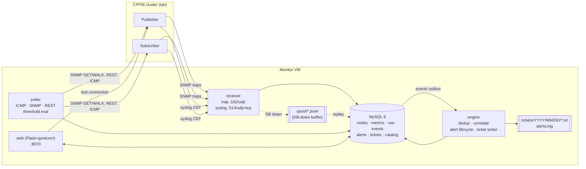

# CPPM Monitor — System Design

**Scope:** Aruba ClearPass Policy Manager (CPPM) only. Cisco ISE is out of scope; the vendor-specific layers are plugins so ISE can be added later.
**Status:** Prototype design (lab CPPM). Target: a single Linux VM with the web UI on port 8070.
**Owner:** Network operations (NAC monitoring).

---

## 1. Problem Breakdown

| Need | Interpretation |
|---|---|
| Proactive monitoring | Poll CPPM nodes over **SNMP + REST API + ICMP**, store time-series data, show a dashboard, and evaluate thresholds so issues are caught before users notice |
| Reactive monitoring | Receive **SNMP traps (UDP/162)** and **syslog (UDP+TCP/514)** from CPPM, normalize them into events, then correlate and deduplicate them into alerts |
| Ticketing | There is no ServiceNow API yet. Each actionable alert produces a **ServiceNow-ready ticket as a .txt file** plus an append-only alert log. The ticket sink is an interface, so the SNOW REST API can be plugged in later |
| Prototype UX | Web UI on :8070 where you add a CPPM (IP, SNMP v2c/v3 credentials, API client) and test connectivity, then view the dashboard, live traps, raw syslog, alerts and tickets |
| Unknowns | The syslog format is unknown, so phase 1 stores raw messages and the parser plugins come later. The trap database will be supplied by the user, so the design includes a loader plus a seeded default catalog |

### 1.1 Non-functional requirements

| NFR | Target |
|---|---|
| Scale | Prototype has 1–2 lab nodes. The design must handle **200 CPPM nodes** without changes to the architecture |
| Ingest | Bursts of ≥ 500 traps/s and 2,000 syslog msgs/s without loss at the socket (receivers do no heavy work inline) |
| Detection latency | Trap or syslog → ticket file in ≤ 10 s. Poll-detected threshold breach → ticket in ≤ 1 poll interval + sustain window |
| Availability | The receivers must survive DB, web or engine restarts. If the DB is down, they spool to local disk and replay later |
| Security | Credentials encrypted at rest. The UI requires login. SNMPv3 supported for polling |

### 1.2 Constraints

- Python 3.11+ on Linux (RHEL 8/9 assumed; Ubuntu also works). Flask for the web layer, matching the team's standard stack.
- MySQL 8 is the team standard. SQLite is a fallback only for a no-sudo lab.
- UDP/162 and UDP/TCP/514 are **privileged ports**. Use systemd `AmbientCapabilities=CAP_NET_BIND_SERVICE`; do not run the app as root.
- The server may not have internet access, so frontend libraries (Chart.js, HTMX) are vendored into `static/`, not loaded from a CDN.

---

## 2. Research findings that shape the design

### 2.1 SNMP polling — CPPM-MIB (`1.3.6.1.4.1.14823.1.6.1.1`)

`cppmSystemTable` (`…1.1.1.1.1.<col>.<idx>`) is a **table**, so every GET needs an instance index. Discover the index once per node by GETting several candidate indices in one PDU, then cache it.

| Col | Object | Use | Note |
|---|---|---|---|
| 1 | cppmSystemModel | Inventory | |
| 2 | cppmSystemSerialNumber | Inventory / CI | |
| 3 | cppmSystemVersion | Inventory, upgrade detection | |
| 4 | cppmSystemHostname | Identity / index discovery | |
| 5 | cppmClusterNodeType | Publisher/Subscriber | Detects role changes |
| 7 | cppmNumClusterNodes | Cluster size | A drop means a node left |
| 8 / 10 | Mgmt / Data port IP | Identity | |
| 12 / 13 | Memory total / free | RAM % | **Bytes** per the HPE docs. "Free" excludes cache, so pair it with UCD `memAvailReal` |
| 14 / 15 | Disk total / free | Disk % | Bytes |
| 16 | cppmSystemNumCPUs | Inventory | |
| 17 | cppmSystemUptime | Reboot detection | A decrease means a reboot |

`policyServerTable` (`…1.1.2.3.1.<col>`), indexed by hostname (a string index), so **walk** these columns, don't GET them:

| Col | Object | Use |
|---|---|---|
| 14/15/16 | psAuthCounterSuccess/Failure/Total | Auth rate (delta per interval) |
| 17/18/19 | dailySuccessAuthCount / dailyFailedAuthCount / dailyTotalAuthCount | Auth success %. **The counters reset at 00:00**, so a negative delta means a reset; treat the new value as the delta |

Also walk `radiusServerTable` (`…2.1`), `tacacsAuthTable` (`…2.7`), `radiusServerAuthTable` (`…2.2`, per auth source, which helps spot AD/LDAP failures) and `networkTrafficTable` (`…3.1`).

**CPPM-MIB has no pollable CPU utilization.** `cppmCPUAverageLoad` only exists as a trap varbind. Use standard MIBs for CPU:

| Metric | OID |
|---|---|
| CPU raw ticks (accurate %) | UCD `ssCpuRawUser/System/Idle` `1.3.6.1.4.1.2021.11.50/52/53.0` (compute the delta between polls) |
| Load avg | UCD `laLoad` `1.3.6.1.4.1.2021.10.1.3.1-3` |
| Mem available | UCD `memAvailReal` `.2021.4.6.0`, `memCached` `.2021.4.15.0` |
| Per-mount disk | `hrStorageTable` `1.3.6.1.2.1.25.2.3` |
| Uptime / reboot | `sysUpTime` `1.3.6.1.2.1.1.3.0` |
| Interfaces | IF-MIB `ifInOctets/ifOutOctets/ifIn/OutErrors/Discards` (from the HPE CPPM docs) |

Hardware sensors (fan, PSU, disk) come only from the HPE agent MIBs on physical C-series appliances, not on VMs. They are **out of scope for the lab** and would be a future plugin.

### 2.2 SNMP traps — CPPM enterprise traps (`…1.1.200.10xx`)

| OID suffix | Trap | Default severity | Ticket | Clears with |
|---|---|---|---|---|
| 1001 | cppmLicenseExpiry | Medium | Yes | — (polled license state) |
| 1002 | cppmActivationExpiry | Medium | Yes | — |
| 1003 | cppmNodeCertExpiry | Medium (≤7d: High) | Yes | API cert poll shows renewal |
| 1004 | cppmLowDiskSpace | Medium | Yes | Polled disk < clear threshold |
| 1005 | cppmLowMemory | Medium | Yes | Polled memory < clear threshold |
| 1006 | cppmClusterNodeAddNotification | Info | No | — |
| 1007 | cppmClusterNodeDelNotification | High | Yes | — |
| 1008 | cppmClusterNodePromNotification | High (publisher change) | Yes | — |
| 1009 | cppmClusterNodeDbldNotification | High | Yes | — |
| 1010 | cppmClusterNodeNSyncNotification | High | Yes | No further out-of-sync traps for 15 min AND API shows the node in sync |
| 1011 | cppmClusterPwdChangeNotification | Info (audit) | No | — |
| 1012 | cppmConfigReset | High (security) | Yes | — |
| 1013 | cppmConfigRestore | Medium | Yes | — |
| 1014 / 1015 | cppmUpdate / cppmUpgradeNotification | Info (Medium if status ≠ success) | Conditional | — |
| 1016 | cppmClusterLicenseUsage | Info. Raise Medium when usage/total ≥ 90% | Conditional | Usage < 85% |
| 1017 | cppmServiceStopNotification | **High if the service is RADIUS/TACACS/Policy server/DB**, otherwise Medium | Yes | **1018 or 1019 with the same `cppmServiceName`** |
| 1018 | cppmServiceStartNotification | Info (clear) | No | — |
| 1019 | cppmServiceRestartNotification | Info (clear) | No | — |
| 1021 | cppmHighCPULoadNotification | Medium | Yes | Polled CPU < clear threshold |
| 1022 | cppmCoreDumpNotification | High | Yes | — |
| 1023 | cppmClusterLicenseOverrun | High | Yes | — |
| std | coldStart / warmStart (`1.3.6.1.6.3.1.1.5.1/.2`) | High (reboot) | Yes | — |

Varbinds live under `…1.1.200.100.<n>`, for example `cppmNodeIp` (.2), `cppmServiceName` (.17) and `cppmTrapMessage` (.35). The **user-supplied trap database overrides this seed** (see §6.4).

CPPM's System Monitor UI also lists per-service start/stop traps (TACACS server, DB replication, Async DB write, and so on). These arrive as 1017/1018/1019 with the service name in a varbind. **Any OID not in the catalog is still stored and surfaced as `UNKNOWN_TRAP` (Info).** Nothing is dropped.

v2c traps have no agent-address field. Identify the sender by the **UDP source IP**, and fall back to the `cppmNodeIp` varbind when NAT or a VIP masks it.

### 2.3 REST API (OAuth2 `client_credentials`)

`POST /api/oauth` returns a bearer token. Cache it and refresh at 80% of `expires_in`. Create the API client in Guest → Administration → API Services with a **read-only operator profile**.

| Endpoint | KPI it covers (the email marked these "NA") |
|---|---|
| `GET /api/cppm-version`, `GET /api/server/version` | Version and inventory |
| `GET /api/cluster/server` | Cluster membership, node UUIDs, publisher/subscriber role |
| `GET /api/server/service/{server_uuid}` | **RADIUS / TACACS / Policy server / DB service status** |
| `GET /api/server-cert`, `GET /api/server-cert/name/{uuid}/{service}` | **Certificate expiry** (HTTPS, RADIUS/EAP, RadSec) |
| `GET /api/cert-trust-list` | Trust-list CA expiry |
| `GET /api/application-license` (+ license summary, verify in Swagger) | **License utilization** |
| `GET /api/endpoint?calculate_count=true&limit=1` | **Active endpoint count** (read `count` only, never page through all endpoints) |
| `GET /api/session?...` (verify in Swagger) | Active sessions |

Exact paths and payloads vary by version. **Verify them against `https://<cppm>/api-docs` on the lab version** and make each API collector tolerant of 404 (mark the KPI "unsupported on this version", don't crash).

### 2.4 Syslog

CPPM path: Administration → External Servers → **Syslog Targets** + **Syslog Export Filters**. Export templates are *Audit Records, System Events, Session Logs, Insight Logs*, and the format can be *Standard / LEEF / CEF*.

Recommendation for the lab:
- Export filter 1: **System Events, CEF**. This is the primary feed for reactive alerting.
- Export filter 2: **Audit Records, CEF**. Covers config-change audit.
- Session/Insight logs are high volume. Leave them off until the parser and retention are proven.

Phase 1 stores **raw** syslog plus a lightweight envelope parse (RFC3164/5424 header). The parser is a plugin chain (`CEF → LEEF → CPPM-Standard key=value → raw`), and the first match wins. Syslog alert rules (for example System Events `Level=ERROR` matching a set of categories) are phase 2, once real samples have been captured from the lab.

---

## 3. KPI → method mapping (CPPM; fills the "NA" gaps in the Wi-Fi proposal)

| KPI (from the email) | Method | Source detail | Poll interval | Alert rule |
|---|---|---|---|---|
| Node Up/Down | ICMP + SNMP + API (multi-signal) | ICMP echo, sysUpTime GET, `/api/cppm-version` | 30 s ICMP, 60 s SNMP | **Down only if ICMP AND SNMP fail for 3 consecutive cycles**. ICMP OK but SNMP+API failing means "Degraded/Management unreachable" (Medium) |
| CPU Utilization | SNMP (UCD raw ticks) + trap 1021 | §2.1 | 60 s | > 85% for 5 min (High at > 95%). Clear < 75% |
| Memory Utilization | SNMP (CPPM-MIB + UCD memAvail) + trap 1005 | §2.1 | 60 s | Used (excluding cache) > 85% for 5 min. Clear < 75% |
| Disk Utilization | SNMP + hrStorage + trap 1004 | §2.1 | 5 min | > 80% Medium, > 90% High. Clear < 75% |
| Authentication Rate | SNMP `psAuthCounterTotal` delta | policyServerTable | 60 s | Trend only. Optional anomaly alert vs a 7-day baseline (phase 2) |
| Auth Success / Failure Rate | SNMP daily counters delta | dailySuccess/Failed/Total | 60 s | Failure % > X% for 10 min with total > min volume (avoids false alerts on low traffic) |
| Active Endpoints | REST | `/api/endpoint?calculate_count=true` | 15 min | Trend only (capacity) |
| License Utilization | REST + traps 1016/1023 | application-license | 6 h | ≥ 90% Medium, overrun (1023) High |
| Cluster Sync Status | Trap 1010 + REST cluster/server + SNMP `cppmNumClusterNodes` | | 5 min | Trap or node count drop → High |
| RADIUS Service Status | REST service list + traps 1017/1018/1019 | `/api/server/service/{uuid}` | 2 min | Not running → High |
| TACACS Service Status | Same | Same | 2 min | Same |
| Certificate Expiry | REST server-cert + trust list + trap 1003 | | 6 h | ≤ 30 d Medium, ≤ 7 d High, expired Critical |
| Database Health | REST service status (DB, Async DB write, DB replication services) + trap 1017 | | 2 min | Stopped → High |
| Node Uptime / Reboot | SNMP sysUpTime / cppmSystemUptime + coldStart trap | | 60 s | Uptime decreased → "Reboot detected" High |
| Interface errors (added) | SNMP IF-MIB | | 5 min | Error/discard rate > threshold → Medium |
| Auth source health (added) | SNMP radiusServerAuthTable per source | | 60 s | Per-source failure spike → Medium (catches AD/LDAP outages early) |
| Trap pipeline health (added) | Internal | | | No trap or syslog from a node in 24 h → Info ("verify forwarding config") |

### 3.1 Feedback for the Wi-Fi team (gaps in the proposed KPI list)

1. **Node Down must be multi-signal.** An ICMP-only check produces false tickets during ICMP rate-limiting or when the management plane is busy.
2. **CPU on CPPM is not in CPPM-MIB.** It must come from UCD-SNMP or the trap. The email lists "SNMP", which is correct, but it's from a different MIB.
3. **Memory "free" excludes cache**, so raw free memory will trigger false High Memory tickets. Use available memory.
4. **Daily auth counters reset at midnight**, so the delta logic must handle the reset.
5. **Missing KPIs:** auth-source (AD/LDAP) health, config reset/restore (security event), core dump, publisher promotion, cluster license overrun, reboot via uptime regression, and trap/syslog forwarding health.
6. **Ticket clear logic is missing.** Service stop/start traps pair up, and threshold alerts need hysteresis. Without these, every flap creates a new ticket.

---

## 4. Architecture

### 4.1 Planes

| Plane | Components | Responsibility |
|---|---|---|
| **Data plane (ingest)** | `receiver` service: SNMP trap listener UDP/162 and syslog listener UDP+TCP/514 | Accept packets fast, persist raw records plus a normalized `event` row. No business logic |
| **Control plane (decisioning)** | `poller` service (SNMP/REST/ICMP scheduler and threshold evaluator) and `engine` service (event → alert → ticket) | Decide what is an incident: dedup, correlate, suppress, clear, ticket |
| **Management plane** | `web` service: Flask UI and JSON API on :8070 | Node onboarding and credentials, dashboards, trap catalog import, thresholds, ticket browsing |

### 4.2 Component diagram



### 4.3 Data flows

**Reactive (trap):**
```
CPPM ─UDP/162─▶ receiver: pysnmp ntfrcv callback
   → resolve node by src IP (fallback: cppmNodeIp varbind)
   → lookup trap_catalog by snmpTrapOID → name, severity, category
   → INSERT raw_traps + INSERT events(processed=0)          [single txn]
engine (loop, 2 s): SELECT events WHERE processed=0 FOR UPDATE SKIP LOCKED
   → rule match → dedup_key = node|rule|instance
   → if clear-event: close matching open alert, append "CLEARED" to its ticket file
   → elif open alert exists: count++, last_seen (no new ticket)
   → elif suppressed (parent node DOWN, maintenance): alert state=suppressed
   → else: create alert → TicketSink.create() → write .txt + alerts.log line
   → UPDATE events processed=1
```

**Proactive (poll):**
```
poller scheduler (per node, per job, jittered):
   ICMP 30 s | SNMP system 60 s | SNMP auth tables 60 s | SNMP disk/if 5 min
   REST services 2 min | REST endpoints 15 min | REST certs/licenses 6 h | inventory 1 h
   → write metrics / service_status / certificates / node_state
   → threshold evaluator (sustain window + hysteresis) emits events (source=poll)
   → same engine path as traps
```

### 4.4 Why four processes (not one)

| Concern | Single asyncio process | 4 systemd units (chosen) |
|---|---|---|
| A slow poll or UI bug blocks the trap socket | Possible, and the UDP buffer overflows | Isolated |
| Restarting the UI or engine during development | Drops traps | Receiver keeps running |
| Complexity | Lowest | Slightly higher, but each unit is small |
| Duplicate tickets | — | Avoided: **the engine is the only writer of alerts and tickets** |

---

## 5. Architecture Decision Records

### ADR-001: Event bus — DB outbox table vs Redis/Kafka
**Status:** Accepted
**Context:** Receivers and the poller must hand events to the engine reliably. Expected volume is low to medium (hundreds of events per minute at 200 nodes).

| Dimension | MySQL outbox (`events.processed`) | Redis Streams | Kafka |
|---|---|---|---|
| Complexity | Low | Medium | High |
| Extra infrastructure | None | Redis | Broker + ZK/KRaft |
| Durability | Transactional with the raw row | AOF config needed | Strong |
| Throughput | Thousands/s, ample here | Very high | Very high |

**Decision:** Use a MySQL outbox with `SELECT … FOR UPDATE SKIP LOCKED` and an index on `(processed, id)`.
**Consequences:** One fewer moving part. If ingest ever exceeds about 5k events/s, swap to Redis Streams behind the same `EventBus` interface.

### ADR-002: Metrics storage — MySQL vs InfluxDB/Prometheus
**Status:** Accepted (for now)
**Context:** Load estimate: 200 nodes × ~40 series × 1/min = 8k points/min, about 11.5M rows/day.
**Decision:** MySQL `metrics` table (narrow, `BIGINT` PK, index `(node_id, metric, ts)`), with **raw retention of 7 days** and **5-min rollups kept 90 days** (`metrics_5m`, produced by a nightly job). The lab is well within MySQL's comfort zone.
**Revisit when:** Grafana or long retention is required, or netatlas integration needs a TSDB. Writes go through a `MetricsStore` interface, so a VictoriaMetrics or Influx backend can be added without touching collectors.

### ADR-003: Trap decoding — compiled MIBs (pysmi) vs catalog-driven OID map
**Status:** Accepted
**Decision:** The **trap catalog (YAML/CSV, imported into the DB) is the source of truth** for trap OID → name, severity and template, and varbind OID → field name. There is no runtime MIB compilation.
**Why:** It avoids the pysmi dependency chain (ARUBA-MIB imports, etc.), the user's trap database maps directly onto it, and unknown OIDs still get stored.
**Trade-off:** New MIB objects must be added to the catalog. The UI import makes this trivial.

### ADR-004: Web framework — Flask vs FastAPI
**Status:** Accepted: **Flask + gunicorn** for the web layer (team standard). The **asyncio** stack (pysnmp 7 asyncio, httpx, asyncio datagram) is used inside receiver and poller, where concurrency matters.
**Trade-off:** The UI can't share async code paths with the collectors. Collectors expose functions that the UI's "Test connection" runs via `asyncio.run()` in a worker thread.

### ADR-005: Ticket sink abstraction
**Status:** Accepted
`TicketSink` interface: `create(alert) -> TicketRef`, `update(ticket, note)` and `resolve(ticket, note)`.
- `FileTicketSink` (now): writes `tickets/YYYY/MM/DD/CPPM-YYYYMMDD-NNNN.txt` and appends to `tickets/alerts.log`.
- `ServiceNowSink` (later): `POST /api/now/table/incident`. Same alert model, no engine change.

### ADR-006: Privileged ports
**Status:** Accepted. Run as service user `cppmmon` with systemd `AmbientCapabilities=CAP_NET_BIND_SERVICE` on the receiver unit only.
Rejected alternatives: running as root (security risk), and iptables REDIRECT 162→1162 (it hides the real port and complicates troubleshooting). A fallback is config-driven: `RECEIVER_TRAP_PORT=1162` plus a firewalld forward-port, for hosts where systemd caps aren't allowed.

---

## 6. Data model (MySQL 8, InnoDB, utf8mb4)

```sql
-- Inventory / credentials
nodes(id PK, name, ip UNIQUE, site, role ENUM('publisher','subscriber','unknown'),
      snmp_version ENUM('2c','3'), snmp_community_enc, snmp_v3_user, snmp_v3_auth_proto,
      snmp_v3_auth_key_enc, snmp_v3_priv_proto, snmp_v3_priv_key_enc, snmp_port DEFAULT 161,
      api_enabled, api_client_id, api_client_secret_enc, api_verify_tls BOOL,
      trap_community_enc,  -- community CPPM uses when SENDING traps (may differ from poll community)
      enabled BOOL, maintenance_until DATETIME NULL, created_at, updated_at)

node_state(node_id PK FK, status ENUM('up','degraded','down','unknown'), sys_index INT,
           hostname, version, model, serial, node_type, cluster_size, cluster_uuid,
           uptime_s BIGINT, last_icmp_ok, last_snmp_ok, last_api_ok,
           last_trap_at, last_syslog_at, updated_at)

-- Time series
metrics(id BIGINT PK, node_id, ts DATETIME(3), metric VARCHAR(64), value DOUBLE,
        instance VARCHAR(128) DEFAULT '',            -- e.g. mount, auth source, interface
        INDEX(node_id, metric, ts))
metrics_5m(node_id, metric, instance, bucket DATETIME, avg, min, max, PRIMARY KEY(node_id,metric,instance,bucket))
counter_state(node_id, metric, instance, last_value BIGINT, last_ts, PRIMARY KEY(node_id,metric,instance))  -- delta calc

service_status(node_id, service_name, status, raw JSON, ts, PRIMARY KEY(node_id, service_name))
certificates(id, node_id, cert_type, service, subject, issuer, valid_to, days_left, ts)
licenses(id, node_id NULL, app_name, total, used, expires_at, ts)

-- Reactive ingest
trap_catalog(oid PK, name, category, alarm_type, severity ENUM('critical','high','medium','low','info'),
             create_ticket BOOL, clear_oid NULL, clear_match_field NULL,   -- e.g. cppmServiceName
             title_tpl, description_tpl, recommended_action, source_ref, updated_at)
varbind_catalog(oid_prefix PK, name)                 -- …200.100.17 → cppmServiceName
raw_traps(id BIGINT PK, received_at, src_ip, node_id NULL, snmp_version, community_ok BOOL,
          trap_oid, trap_name, varbinds JSON, INDEX(received_at), INDEX(node_id, received_at))
raw_syslog(id BIGINT PK, received_at, src_ip, node_id NULL, transport, facility, severity,
           host, app, msg TEXT, fmt ENUM('cef','leef','cppm_std','rfc5424','rfc3164','raw'),
           parsed JSON NULL, INDEX(received_at), INDEX(node_id, received_at))

-- Decisioning
events(id BIGINT PK, ts, node_id NULL, source ENUM('trap','syslog','poll','internal'),
       event_type VARCHAR(64), severity, is_clear BOOL, dedup_instance VARCHAR(128),
       attributes JSON, raw_ref VARCHAR(64), processed TINYINT DEFAULT 0, INDEX(processed, id))
thresholds(rule_id PK, metric, instance_glob, op, warn_value, crit_value, clear_value,
           sustain_s, severity_warn, severity_crit, enabled)
alerts(id PK, dedup_key, node_id, rule_id, severity, state ENUM('open','cleared','suppressed'),
       title, first_seen, last_seen, occurrences, cleared_at NULL, ticket_id NULL,
       UNIQUE KEY uq_open (dedup_key, open_marker))   -- open_marker = 1 when open, NULL when closed
tickets(id PK, ticket_no UNIQUE, alert_id, created_at, priority, short_description,
        file_path, status ENUM('new','resolved'), resolved_at NULL)

-- Ops
audit_log(id, ts, user, action, target, detail JSON)
users(id, username, password_hash, role)
```

**Retention jobs:** `raw_syslog` 30 days, `raw_traps` 90 days, `events` 30 days, `metrics` 7 days (after rollup), `metrics_5m` 90 days. Alerts and tickets are kept indefinitely. Delete in batches of 10k so tables aren't locked.

### 6.4 Trap database import format (for the user-supplied trap DB)

Accept **CSV or YAML** with these columns:
`oid, name, category, alarm_type, severity, create_ticket, clear_oid, clear_match_field, title_tpl, description_tpl, recommended_action`

Templates use Jinja2 with `{{node.name}}`, `{{node.ip}}`, `{{vb.cppmServiceName}}`, `{{vb.cppmTrapMessage}}` and so on. The import is an upsert, with a diff preview in the UI before commit. Seed file: `catalog/cppm_traps.yaml` (§2.2).

---

## 7. Alert engine rules

1. **Dedup key** = `node_id | event_type | dedup_instance` (instance is, for example, the service name, mount point or cert subject).
2. **One open alert per key.** Repeats increment `occurrences` and `last_seen`, and append a "re-occurred" line to the existing ticket file at most every 30 min. No new ticket is created.
3. **Clear** comes from a pairing trap (1018/1019 for 1017 matched on `cppmServiceName`) or a poll below `clear_value`. Clearing sets the alert to `cleared`, marks the ticket `resolved`, and appends a RESOLVED block to the file.
4. **Flap guard:** if the same key opens and clears more than 3 times in 30 min, keep it open as "FLAPPING" (severity +1) and stop toggling.
5. **Correlation / suppression:** while a node is `down`, all other alerts for that node are `suppressed` and listed under the parent ticket. A cluster-wide event (for example a publisher out of sync on all subscribers) groups into one ticket keyed by cluster.
6. **Maintenance window:** `nodes.maintenance_until` means events are stored but no tickets are created.
7. **Severity → SNOW priority:** Critical → P1 (Impact 1/Urgency 1), High → P2, Medium → P3, Low/Info → no ticket (log only), which matches the email's matrix.

---

## 8. Ticket file format (ServiceNow-ready)

```
================================================================
TICKET      : CPPM-20261117-0007
CREATED     : 2026-11-17 14:32:05 IST
STATUS      : NEW
----------------------------------------------------------------
Caller              : CPPM-Monitor (automation)
Category            : Network
Subcategory         : AAA/NAC
Configuration Item  : cppm-pub-01 (10.10.10.5) | Publisher | 6.12.x | SN: XXXX
Assignment Group    : Network Operations
Impact / Urgency    : 2 / 2
Priority            : P2 - High
Short Description   : [CPPM][HIGH] RADIUS service stopped on cppm-pub-01
----------------------------------------------------------------
Description:
  Alarm Type     : Application Failure
  Source         : SNMP Trap (cppmServiceStopNotification, .1.3.6.1.4.1.14823.1.6.1.1.200.1017)
  First Seen     : 2026-11-17 14:32:04 IST
  Node           : cppm-pub-01 / 10.10.10.5
  Service        : Radius server
  Trap Message   : <cppmTrapMessage>
  Impact         : RADIUS authentication requests to this node will fail;
                   NADs fail over to the secondary RADIUS server if one is configured.
Evidence:
  raw_trap_id=12345  varbinds={...}
  Last poll: CPU 12% | Mem 61% | Disk 40% | Services: radius=STOPPED tacacs=RUNNING
Recommended Action:
  1. Verify in CPPM: Administration > Server Manager > Server Configuration > Services Control
  2. Check Event Viewer for the reason the service stopped
  3. Start the service; if it fails to start, escalate per matrix
----------------------------------------------------------------
UPDATES:
  2026-11-17 14:36:10  RESOLVED  cppmServiceStartNotification received (Radius server)
================================================================
```

`alerts.log` is one JSON line per lifecycle change (`opened/reoccurred/cleared/suppressed`). That gives a grep-friendly audit trail, and it can later be shipped to netatlas or a SIEM.

---

## 9. Web UI (:8070)

| Page | Function |
|---|---|
| Login | Local admin (bcrypt). Session cookie |
| **Nodes** | Add/edit CPPM: name, IP, SNMP v2c community **or** v3 (user/auth/priv), trap community, API client id/secret, TLS verify. **[Test connection]** runs ICMP, SNMP sysName + CPPM index discovery, and an API token + version call, and shows a per-check pass/fail with the error text |
| **Dashboard** | Tile per node: status, role, version, uptime, CPU/Mem/Disk gauges, auth success %, RADIUS/TACACS service state, nearest cert expiry, license %, open alerts. Auto-refresh 30 s |
| Node detail | Charts (Chart.js, vendored): CPU/Mem/Disk, auth rate, success/failure, per-auth-source failures. Service table, certificate table, recent traps/syslog |
| **Live Traps** | Last N traps, filter by node/OID, expand to see varbinds. Unknown traps highlighted |
| **Live Syslog** | Raw tail (polling `/api/syslog?after_id=`), filter by node/text, detected format column |
| **Alerts** | Open/cleared/suppressed, occurrences, linked ticket |
| **Tickets** | List, view, download .txt |
| Trap Catalog | View, upload CSV/YAML, diff preview, apply |
| Thresholds | Edit rules |
| Health | Receiver packet counters, spool backlog, engine lag (oldest unprocessed event age), poller job durations and failures |

---

## 10. Edge cases and failure handling

| Case | Handling |
|---|---|
| Trap from an unregistered IP | Store with `node_id=NULL`, show "Unregistered sender" in Live Traps, no ticket |
| Wrong trap community | Count it in health metrics (`community_ok=false`). Never auto-accept |
| v3 traps | Not in prototype (requires the sender engineID). Documented as phase 2 |
| CPPM index not 0/1 | Probe the candidate list in one PDU, then fall back to a walk of the hostname column |
| SNMP `noSuchInstance` per varbind | Mark that KPI `unsupported`. Never shift fields (parse per OID, not positionally) |
| Counter reset (midnight, reboot, 32-bit wrap) | Negative delta → if the uptime dropped, treat as a reboot, otherwise treat as a reset (delta = new value) |
| API token expiry / 401 | Refresh once, then retry. Repeated 401 → node API state `auth_failed` (Medium alert "API credentials invalid") |
| API 404 on older/newer CPPM | Mark the KPI unsupported for that node. Log once, not every cycle |
| CPPM self-signed TLS | Per-node `api_verify_tls` toggle. Default off in the lab, warn in the UI |
| DB down | Receiver writes JSONL to `spool/` (rotated at 100 MB) and replays it on reconnect, in order and idempotent by `(src, ts, hash)` |
| Syslog > 64 KB UDP / TCP framing | Truncate to the configured max. TCP supports both octet-counting (RFC6587) and LF framing |
| Clock skew | Use the server receive time as the primary timestamp. Keep the device timestamp in `parsed` |
| Trap storm | Receiver is non-blocking. Engine dedup collapses repeats. Per-node rate limit: above 50 events/s, aggregate into one "Trap storm" alert |
| Port already in use (`snmptrapd`, `rsyslog`) | Install script checks with `ss -lunpt` and stops/disables conflicting units after confirmation |
| SELinux enforcing | Services run as `unconfined_service_t` via systemd. If SELinux denies binding the ports, document `semanage port` steps instead of disabling SELinux |
| Ticket file write failure (disk full) | Keep the alert in the DB with `ticket_id=NULL`, retry every 60 s, raise an internal alert |

---

## 11. Optimization / scaling path

- **Poll scheduling:** jitter each job by ±10% so 200 nodes don't fire at the same second. Cap concurrency with `asyncio.Semaphore(50)` for SNMP and 20 for REST.
- **PDU batching:** one GET for all system-table columns. Use GETBULK (`max-repetitions=25`) for table walks.
- **Writes:** batch metric inserts per poll cycle with `executemany`, not one row at a time.
- **Engine:** process events in batches of 500. All alert state is in the DB, so the engine is restart-safe.
- **Horizontal scale (later):** run multiple poller instances that shard nodes by `node_id % N`. The receiver can sit behind a UDP load balancer that preserves the source IP. The engine stays single-writer, or uses a DB advisory lock for leader election.
- **netatlas integration (later):** expose `/api/v1/export/inventory` and `/api/v1/export/kpis` (JSON) so netatlas data modelling consumes a stable contract rather than reading the DB directly.

---

## 12. Phased delivery (matches CLAUDE.md)

| Phase | Deliverable | Exit criteria |
|---|---|---|
| 0 | VM preflight, repo skeleton, venv, DB, systemd units, firewall | `systemctl status cppmmon-*` all active; :8070 serves the login page |
| 1 | Node onboarding UI + Test Connection | Lab CPPM passes ICMP/SNMP/API tests from the UI |
| 2 | Receiver: traps + raw syslog | `snmptrap` simulation of all 22 seed traps shows them decoded in Live Traps. `logger` test plus the real CPPM syslog appear raw |
| 3 | Poller + dashboard | Lab CPPM tiles show live CPU/Mem/Disk/auth/services/certs |
| 4 | Engine + file tickets | Simulated 1017 → ticket file. 1018 → the same ticket is marked RESOLVED. A threshold breach (lowered threshold) → ticket |
| 5 | Syslog parsers (CEF/LEEF/std) from captured lab samples + syslog rules | Real CPPM System Events parsed into fields |
| 6 | Hardening: retention, rollups, health page, SNMPv3 traps, backup | 48 h soak with no memory growth or engine lag |

## 13. Open items / revisit

- The trap database from the user will replace or extend `catalog/cppm_traps.yaml`.
- Verify the REST endpoint paths against the lab CPPM's Swagger (`/api-docs`).
- Decide the production DB host (local MySQL vs shared). Decide the HA requirement (active/passive VM?).
- The HPE KB `sf000096265` was not machine-readable during research (JS-rendered). Read it manually and fold any constraint into §2.
- ISE plugin (separate collector set: MnT REST, ISE SNMP, ISE syslog categories) once CPPM is stable.
